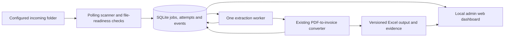

# Continuous PDF-to-invoice pipeline and admin dashboard

Status: Stages 1–3 implemented and verified; Stage 4 awaits user approval. Implement one stage at a time, prove its acceptance checks, and ask the user before proceeding. Existing single-file/batch conversion and BD invoice contents/formatting remain supported. See the [Stage 1](pipeline_stage1.md), [Stage 2](pipeline_stage2.md) and [Stage 3](pipeline_stage3.md) acceptance reports.

## Outcome and boundaries

Watch one configured local folder for incoming PDFs, process stable arrivals automatically, and save their invoices using the shared BD template. A local web dashboard shows queue counts, component health, job stages, issues, output files and source/model evidence. Review information belongs in the dashboard, never as validation or intervention text on an invoice. Production never reads manual expected outputs.

Start with one extraction worker on this PC. The existing vision allowance (4,096 output tokens, 8,192 context and two-hour request timeout) stays unchanged. Long inference must not block folder scanning, dashboard responses or service heartbeats. The PC must be awake; stopped services discover missed arrivals on their next scan.

## Existing capabilities and missing pieces

| Area | Exists now | Addition needed |
|---|---|---|
| Conversion | `src/foc_extractor/pipeline.run`, PaddleOCR, bounded Qwen3-VL fallback, supported parsing/valuation | Call the same converter from a worker; do not rewrite extraction |
| Invoice appearance | Shared `templates/BD_template.xlsx`; style inheritance; atomic workbook save | Use the same master for every queued job |
| Batch tracking | A JSON manifest for one batch invocation | Durable queue, attempt history, ownership and restart recovery |
| Processing evidence | OCR words/tables/transforms; package/weight evidence; model answer cache; workbook audit | Per-job events, consistent provenance and links to review artifacts |
| Images | PDF pages/crops rendered in memory; some development images in reports | Save exact model-input crops during processing; render source pages on demand |
| Progress | Console messages and final result | Structured stage/page events, elapsed times and independent heartbeats |
| Administration | CLI commands | Local dashboard and guarded queue controls |

## Minimal architecture

- Python `pathlib`, `hashlib`, `sqlite3`, `logging` and existing image/PDF libraries cover discovery, persistence and artifacts. Polling avoids a new file-watcher dependency; start with a five-second scan interval and tune only if needed.
- A small Flask app with plain HTML/CSS/JavaScript is sufficient for the dashboard. Use Waitress for deployment on Windows. These would be the only new web dependencies; add them at the dashboard stage. No frontend build system or external queue/database service is needed.
- Keep scanning/coordination and the extraction worker separate so lengthy OCR/model work cannot freeze administration. The web app reads persisted state; opening a browser never starts another worker.
- Bind the dashboard to `127.0.0.1` initially. LAN/multi-user access is a separate scope requiring authentication and deployment decisions.
- Use Windows Task Scheduler for hidden background startup/restart on this PC initially. Display this accurately as a managed background task, not as a native Windows Service. Decide startup account and Ollama startup together before enabling unattended operation.

References: [Flask deployment](https://flask.palletsprojects.com/en/stable/deploying/) and [Waitress on Windows](https://flask.palletsprojects.com/en/stable/deploying/waitress/).

## Sequential implementation checklist

| Stage | Deliverable | Acceptance gate |
|---|---|---|
| 1 | Configuration and durable job store | Queue/attempt state survives restart; duplicate claims are prevented; existing CLI behavior and tests are unchanged |
| 2 | Folder scanner and safe intake | New stable PDFs queue automatically; partial copies do not run; unchanged files do not loop; changed files become new versions |
| 3 | One background extraction worker | Real PDFs produce invoices through the existing converter; failures are isolated; interrupted work recovers; no existing invoice is overwritten accidentally |
| 4 | Structured processing events and review artifacts | Dashboard data distinguishes OCR, model calls, cache reuse, acceptance/rejection and issues; exact model-input crops can be reviewed |
| 5 | Read-only web dashboard | Health, counts, job history/detail, issues, PDFs, invoice downloads and evidence work while OCR/VL is busy |
| 6 | Admin controls and recovery | Pause/resume, selected retry and save retry work without duplicate attempts or invoice damage |
| 7 | Unattended Windows startup | Background startup, failure restart, single-instance protection and Ollama dependency reporting work without a browser |
| 8 | End-to-end acceptance and operating guide | Restart/copy/duplicate/locked-file/model-failure cases pass; BD regression and unseen-PDF checks pass; recovery instructions are documented |

Stages 1–3 are complete: configuration, durable job/attempt/event state, safe folder intake and a single extraction worker with recoverable publication. Neither scanner nor worker is left running. Dashboard/startup management and Stages 4–8 are not implemented. The user explicitly requires approval before each next stage.

### Stage 1 — configuration and durable state

- [x] Added `pipeline_config.json` for incoming/output/state/artifact paths, a five-second scan interval and the existing model choice. Paths resolve relative to the config file, independent of the working directory. Defaults use `project/incoming`, existing `project/output` and ignored `project/runtime` state/artifacts; actual production intake still needs confirmation. Examples remain tests. No watcher is enabled.
- [x] Added a SQLite-backed job/attempt/event store. Source identity/hash and snapshot reference, states, timestamps, outputs, errors, issues and worker ownership persist. Transactions are short; processing is not performed by the store.
- [x] Added attempt metadata snapshots for configuration, template/rates/application fingerprints and Python/application versions. Actual model digest remains explicitly unknown until processing resolves it in a later stage. Configuration changes do not requeue completed work.
- [x] Defined waiting-for-file, queued, running, waiting-to-save, completed, failed and interrupted states. Queue/claim/finish/interruption/retry history is tested. Stage 2 now stores waiting-for-file readiness separately in intake records; Stage 3 now implements waiting-to-save transitions. Issues remain separate from lifecycle state.
- [x] Existing converter/CLI files remain byte-for-byte unchanged. Baseline 128 tests passed; all 142 tests now pass, including 14 new state/configuration tests. All 78 protected files and the complete reference comparison remain unchanged; 20 invoices/66 source pages/89 goods rows pass output checks.

### Stage 2 — stable folder intake

- [x] Added continuous polling plus `--once`, case-insensitive PDF extensions and existing/later arrival discovery; temporary/hidden/owner files, links, non-files and subfolders are ignored.
- [x] Readiness uses stable metadata and content hash across interval-separated observations. The snapshot is hash-verified, source bytes checked again, and all PDF pages loaded. Missing EOF, password requirements and structural repair are recorded as rejected intake. Atomic producer rename is supported/preferred; stability is not a completion guarantee.
- [x] Preserved the original basename in source-identity/content-versioned input snapshots.
- [x] Same identity/content is idempotent across restart; another basename remains separate and its queued event records related same-content jobs.
- [x] Changed bytes become a new version without altering earlier snapshots/jobs or deleting source PDFs. Missing sources keep accepted snapshots/jobs intact.
- [x] All 159 tests pass, including 17 intake cases and schema migration. Real CLI intake queued all 20 examples in an isolated database, verified all snapshots and created no duplicate jobs after restart. All 81 protected files and the reference comparison are unchanged. Default empty inbox is created/scanned; no scanner remains running. See [Stage 2 details and limits](pipeline_stage2.md).

### Stage 3 — durable worker and output publication

- [x] Claim one queued job transactionally; prevent two worker instances from claiming the same attempt. Give the coordinator and worker independent heartbeats.
- [x] Call the existing converter against the immutable snapshot, preserving the original filename and current template/source policies. Use a job-specific working output directory to prevent collisions.
- [x] Publish completed work atomically. Keep compatible invoice filenames for the first version and a deterministic version suffix/directory for later collisions; never replace an unrelated or historical invoice silently.
- [x] If Excel locks a destination, retain the already generated workbook and mark waiting to save. Retry publication without rerunning expensive OCR/VL.
- [x] On restart, reconcile persisted attempts and completed files. Interrupted jobs can replay from the snapshot using caches. Use recoverable attempts and idempotent publication; do not promise that a crash can never repeat computation.
- [x] Isolate one PDF's failure. Ordinary conversion failures stop that job; unprepared crash recovery is limited to three interrupted attempts. Record lifecycle errors; detailed extraction-stage events remain Stage 4.
- [x] Test successful conversion, worker crash, output-lock recovery, same-name versions, duplicate worker launch and disk/write failures. Compare invoice facts/styles with the baseline.

All 177 tests pass. The real worker completed all 20 example PDFs (66 pages, 89 goods rows) with the same invoice values/styles and reference scores. Restart created no extra attempts. All 82 protected files are unchanged; default state is schema 3 with zero production jobs, and both components are stopped. See [Stage 3 acceptance and operating limits](pipeline_stage3.md).

### Stage 4 — truthful processing evidence

- [ ] Add optional structured observation to the shared pipeline and its OCR/quantity/package/weight/model steps. Existing callers that do not request observation must retain their behavior and return type. Do not scrape console text as the authoritative status API.
- [ ] Record job/attempt, stage, page/region, method, elapsed time, original OCR reading, candidate/final value, accepted/rejected outcome and reason. Separate explicit source values, directory fallback, derived packing sums and approved valuation assumptions.
- [ ] Separate **VL attempted**, **VL contributed an accepted value**, **fresh inference**, and **cached model answer**. A cache hit still uses model-derived information. Do not label a job OCR-only simply because no fresh model call ran.
- [ ] Distinguish rejected answers, unavailable model, invalid/truncated response and no model needed. Persist events for failures as well as successes. Record model name/digest, request settings and available timing/token metrics; missing telemetry stays unavailable.
- [ ] Save the exact PNG bytes sent to the model, including supplied KG headings, resizing/composites and source page/coordinates/transforms. Saving only a new approximation of the region is insufficient for review. Reuse content-addressed artifacts where appropriate.
- [ ] Show source page thumbnails/highlighted regions using the retained coordinate transform. Generate full-page previews on demand rather than storing every page at multiple resolutions. Preserve field-to-source links through grouped goods rows where they already exist; do not invent provenance where it is absent.
- [ ] Keep artifacts in managed job storage, not evaluation reports or arbitrary filesystem links. A cache cleanup must not silently remove retained review evidence. Establish a simple retention policy before enabling cleanup.
- [ ] Test OCR-only, fresh accepted/rejected VL, cached VL, missing images and failed calls. Review records never force human approval or add warnings to printed invoices.

### Stage 5 — read-only admin dashboard

- [ ] Overview: scanner/worker/Ollama health separately, last scan/heartbeat, active stage/page and elapsed time, queued/running/waiting-to-save/completed/failed counts, and completed jobs with issues. Report stale telemetry as unknown/offline rather than implying the invoice is still processing.
- [ ] Jobs: search/filter by filename, invoice number, date, status and issues; show total/history and today's counts with clear definitions, pagination and output links. Separate job counts from retry-attempt counts.
- [ ] Job detail: source PDF, generated invoice download, extracted header/goods summary, stage timeline, errors/warnings, source method, model/cache details, and source/crop comparison. Show the attempt and template/rate version used.
- [ ] Evidence view: OCR reading, exact model-input image, structured answer, accepted result/rejection reason and source-page link. Review remains optional and does not block automatic invoice generation.
- [ ] System view: watched/output folders, template, active model/settings, component versions and dependency/disk status. Reuse available model timing; only add a genuine completion ETA after measured history supports it. Stage elapsed time is available first.
- [ ] Auto-refresh small status endpoints. Heavy PDF/model processing stays outside web requests. Serve files by authorized job/artifact IDs, validate paths and escape source/model text. Do not expose raw arbitrary paths, stack traces or all cache files.
- [ ] Verify that the dashboard remains responsive during a long model request and clearly shows the difference between web availability, worker liveness and actual stage progress.

### Stage 6 — small, safe admin controls

- [ ] Pause/resume queue consumption. Pausing does not kill the current model call; new arrivals may continue to queue. State the behavior clearly in the UI.
- [ ] Retry selected failed jobs and waiting-to-save publications. A deliberate reprocess creates a new attempt and records which source/configuration it used; preserve earlier results.
- [ ] Make commands transactional and idempotent so double-clicks cannot launch duplicate work. Use POST and request protection for mutations even on localhost.
- [ ] Keep settings read-only initially; validate and apply any later path/model changes between jobs. Do not expose arbitrary shell commands or stop the user's Excel/Ollama processes.
- [ ] Defer forced active-job cancellation and bulk reprocessing until their recovery behavior is explicitly implemented and tested.

### Stage 7 — Windows background operation

- [ ] Provide explicit install/start/stop/status instructions and hidden startup via native Task Scheduler. Do not install or enable auto-start during earlier stages.
- [ ] Select the correct user account, local paths and working directory; confirm model/cache/folder permissions. Verify Ollama availability under that account after reboot, not only in the current desktop session.
- [ ] Enable failure restart and single-instance protection. A stopped browser is not a stopped pipeline. A paused worker, missing folder, down Ollama and crashed worker must have distinct dashboard states.
- [ ] Preserve the two-hour generation allowance. Graceful stop finishes/checkpoints current work; an OS termination is handled by interrupted-attempt recovery. Do not label a long request stalled solely because it has no token progress.
- [ ] Rotate logs and document database/artifact backup/restore. Keep runtime state ignored by version control.

### Stage 8 — release gate

- [ ] Run all existing regression tests plus focused queue/intake/recovery/evidence/UI tests introduced at each stage.
- [ ] Process the full BD set through the watcher; preserve existing invoice facts and shared-template styling, with no expected files available to runtime conversion.
- [ ] Exercise fresh OCR and unseen/renamed PDFs, not only warm caches. Verify no duplicate publication after restart, copy completion and lock recovery.
- [ ] Verify model-unavailable and rejected-answer cases are visible in administration while supported invoice values remain usable. No invented completeness/accuracy score or human-intervention text is added to invoices.
- [ ] Restart the PC and verify unattended discovery, worker/dependency health and dashboard access under the chosen startup account.
- [ ] Document daily operation, folder handoff, retry/save recovery, retention, backups and rollback. Deploy each stage only after its gate passes.

## Deferred scope

No cloud services, additional OCR/model changes, distributed/multi-worker execution, LAN exposure, mandatory manual approval, invoice editing UI, emails or external notifications in the first release. These can be separate requests after the local pipeline is stable.

## Current checkpoint

Stages 1–3 are implemented and verified. Ask the user before Stage 4 (structured processing evidence and review artifacts). Do not install startup tasks before their stage. The dashboard should read proven pipeline state rather than becoming a second independent processing implementation.
