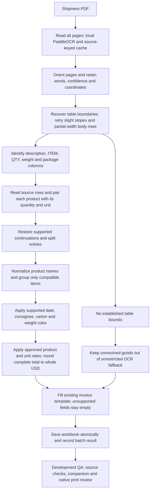

# Shared PDF-to-invoice processing flow

Scope: new shipment PDFs using the supported packing-list structure and the existing BD invoice template. This is a shared source-grounded process, not a claim to understand every PDF layout or unreadable scan. BD estimates use the approved approximate USD rates.

## Ownership of facts

- The PDF supplies shipment facts. An identified company may use the existing maintained address/BIN directory when the PDF lacks them. A company profile must not supply another factory's details.
- OCR preserves coordinates. Physical tables and labelled columns take priority over whole-page text. Slightly sloping ruled lines and body rules spanning only the right part of the table are retried only when ordinary horizontal-boundary recovery fails.
- If QTY and WEIGHT labels are joined, the neighboring column must actually contain recognizable quantity/unit entries before it is accepted as QTY. Kilogram weights are not goods quantities.
- Product/quantity pairs split across ITEM and QTY must have source corroboration. Per-item weight factors and style numbers are not promoted to goods quantities.
- Percentage fragments may join when they establish a complete valid blend without crossing a sender/quantity boundary. Wrapped sender fragments and a later fabric classification can refine the current material group.
- Construction/shrinkage tokens such as 3x3% are distinguished from fiber percentages. A declared STRETCH component is retained literally; it is not silently replaced with a guessed fiber. Different compositions and units remain separate.
- Existing aggregation groups normalized description, unit, HS code and unit price; source row references are retained. Quantity totals must be checked against source rows when grouping changes.

## Conservative behavior

- When OCR words exist but no table bounds are established, unrestricted page text is not used to create goods. A blank is preferable to a footer total, packaging count or staff note presented as an item.
- Existing fallback for bounded unparsed regions remains in the code and is not a universal guarantee of correct classification. Unseen layouts still require evaluation.
- Source-context FAB/FAP/FAR annotations can establish a broad FABRIC SAMPLES category, preserving source units rather than claiming an unreadable subtype. A unique WOVEN/KNIT merged-column value can refine earlier material rows.
- Unnamed columns introduced by pictures are included only when their table headers are blank. Numbered garments split only when independently read inline quantities agree with the declared total. A complete matching garment annotation immediately below the final row is bounded to its description span and cannot create an extra item.
- Integer quantities of explicitly named countable cards can infer PCS; this is recorded internally as context inference, not literal source text. Other unreadable quantity/unit fields remain unresolved. Invoice identifiers now use the approved best-effort policy: PDF/filename exact agreement, otherwise most frequent PDF reading (first on ties), with close-filename correction for a single reading and filename fallback when no PDF number exists. No recognized number in either source still leaves a blank. Selection is internally recorded; misleading or removed filename support can affect the result, so renamed/unseen production files still need acceptance testing.
- A printed garment title can be used even if a handwritten composition cannot be established. Fiber-adjacent OCR glyph repairs and matching garment notes are retained with diagnostics; when a percentage remains unreadable, a supported cotton-fabric description can be used without inventing that percentage. No expected-workbook value may fill that gap.
- Dates follow explicit export/shipment dates first, then the approved first dated packing-page rule. ON/ABT dates are not invented from a packing date.
- Gross weight uses an explicit declaration first, otherwise the approved complete corrected packing-weight sum, counting shared cells once with no arbitrary allowance/rounding. Unreadable corrections leave the total blank. Explicit net greater than known gross leaves net blank.
- Package totals use an explicit shipment total first, then established carton ranges; otherwise count distinct explicit carton IDs or sum PDF package entries across all pages. Shared physical cells and repeated OCR of the same cell count once. Equal counts on different pages are separate unless an explicit carton ID repeats. Packs, cartons, boxes, rolls and bags are containers under this rule; this does not establish consolidated outer cartons. Unreadable declared counts leave the total empty. Gross weight and page count never establish a package count. Source-keyed package evidence is cached under `.cache/ocr/packages`.
- Shipment-specific commercial notes cannot be derived from examples. Missing commercial inputs stay empty.
- BD valuation reads the approved rates in `valuation_rates.json`. Match both product and unit; never replace source quantities with example quantities. Only the six confirmed small-button categories interpret G as GROSS. Unsupported products/units remain unpriced. Existing declared source values take priority.
- General sample-piece and garment rates may price a broad category while its exact description remains unresolved. Specific category rates take priority; fabric-sample/handloom context takes priority over garment words in booking text. Missing source units remain missing. Rates are nominal assumptions calibrated against development references, never shipment-ID rules. The revised common mould rate is USD 0.72/set; see the [expanded valuation report](../reports/valuation_expanded_20261019/RESULTS.md).
- Multiply with Decimal, round each line to cents, then round the sum to whole USD (half up). Populate an estimated shipment total only when every extracted row is priced and all known PDF pages were processed. This does not prove every source row was extracted. Unit rates and line amounts use the existing Extracted_Items sheet; the invoice retains its total-only layout.

## Production and evaluation are separate

Production conversion reads PDFs, the blank template, maintained company information, approved valuation rates and optional source-keyed OCR/model caches. It never reads expected_outputs or QA reports. The manual workbooks are evaluated only by the comparison tool after generation, and source-correct differences must be recorded rather than forced to match.

The current writer still includes internal audit/item sheets in the workbook. Professional customer-only export, remaining print clipping/continuation identity, and applicable company notes are unfinished work; this document does not mark them complete.

## Acceptance before calling this production-ready

1. Keep previous source-supported dates, addresses/BINs, identifiers, cartons and weights stable when repairing goods.
2. Check table quantities against source pages; detect duplicate source ownership and cross-unit mistakes.
3. Inspect actual Excel print output, including continuation pages and missing-field handling.
4. Measure new unseen PDFs and renamed inputs, including fresh OCR, not only cached development examples.
5. Keep unsupported annotations, carton consolidations and commercial details empty until a general source-supported rule works.

Current measured results and unresolved work are linked from [the repair checklist](../reports/carton_fix_20261019/CHECKLIST.md). Unit tests and page coverage support engineering reliability; they do not establish unseen-document accuracy.

Latest source evidence and remaining reference differences: [PDF-priority verification](../reports/pdf_priority_20261019/RESULTS.md). All 20 totals now populate; this does not establish full invoice or unseen-file accuracy.

Invoice-number policy was relaxed on 20 October 2026 at the user's request: [results and decision rules](../reports/invoice_number_fix_20261020/RESULTS.md). Both prior blanks are filled; 18/18 paired numbers match and 109 tests pass. This is development-set evidence, not a production accuracy guarantee.

Package counting updated 20 October 2026: [results and per-page evidence](../reports/package_count_fix_20261020/RESULTS.md). Four missing totals filled; 19/20 package counts present, with 5188 blocked by a handwritten number. All 121 tests pass; existing goods and other invoice fields are unchanged.

## Local vision and productivity note — 20 October 2026

Retain crop-based local vision as a candidate fallback for handwriting that PaddleOCR cannot read. The Qwen3-VL probe identified the confirmed package quantity of one, but its CPU-only run took 24 minutes 40 seconds and hit the old output cap without final JSON. Local requests now allow 4,096 output tokens, an 8,192-token context and a two-hour timeout. Better hardware, with enough capacity to offload the chosen model to a GPU, is a productivity requirement to evaluate before deployment. Benchmark actual cell latency and accepted transcription accuracy on that hardware; do not assume a specific speedup. An isolated package-cell test now returns a correct final structured response with the new limit. Package-cell integration, reliable corrected-weight output, repeated-run reliability and unseen-file accuracy remain unverified. Full-page vision is not required by this proposal.

Actual follow-up benchmark: [512-token validation](../reports/vision_validation_512_20261020/RESULTS.md). Isolated package count accepted; combined and isolated corrected-weight runs reached the output cap without a final answer. More tokens and faster hardware alone do not establish reliable corrected-weight extraction.

## Corrected-weight capability demonstrated — 20 October 2026

The [expanded-limit numeric-weight benchmark](../reports/weight_vision_4096_20261020/RESULTS.md) returns five correct final readings: 5189 page-1 corrections 25/12 kg and 5191 corrections 8.5/8.5/10 kg. Each test supplies a single cell and the source KG header, then requests only a number. All responses finish below 512 tokens despite the larger 4,096-token allowance. This demonstrates capability on these inputs; production integration, automatic crop recovery, repeated-run consistency and unseen accuracy remain pending. Existing invoice metrics and two gross-weight blanks are unchanged.
