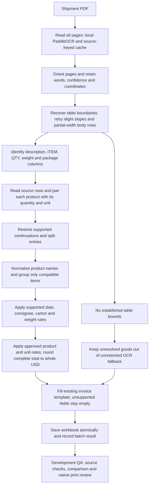

# Shared PDF-to-invoice processing flow

Scope: new shipment PDFs using the supported packing-list structure and the existing BD invoice template. This is a shared source-grounded process, not a claim to understand every PDF layout or unreadable scan. BD estimates use the approved approximate USD rates.

## Ownership of facts

- The PDF supplies shipment facts. An identified company may use the existing maintained address/BIN directory when the PDF lacks them. A company profile must not supply another factory's details.
- OCR preserves coordinates. Physical tables and labelled columns take priority over whole-page text. Slightly sloping ruled lines and body rules spanning only the right part of the table are retried only when ordinary horizontal-boundary recovery fails.
- If QTY and WEIGHT labels are joined, the neighboring column must actually contain recognizable quantity/unit entries before it is accepted as QTY. Kilogram weights are not goods quantities.
- Product/quantity pairs split across ITEM and QTY must have source corroboration. Per-item weight factors and style numbers are not promoted to goods quantities.
- Percentage fragments may join when they establish a complete valid blend without crossing a sender/quantity boundary. Wrapped sender fragments and a later fabric classification can refine the current material group.
- Construction/shrinkage tokens such as 3x3% are distinguished from fiber percentages. A declared STRETCH component is retained literally; it is not silently replaced with a guessed fiber. Different compositions and units remain separate.
- Existing aggregation groups normalized description, unit, HS code and unit price; source row references are retained. Quantity totals must be checked against source rows when grouping changes.

## Conservative behavior

- When OCR words exist but no table bounds are established, unrestricted page text is not used to create goods. A blank is preferable to a footer total, packaging count or staff note presented as an item.
- Existing fallback for bounded unparsed regions remains in the code and is not a universal guarantee of correct classification. Unseen layouts still require evaluation.
- Source-context FAB/FAP/FAR annotations can establish a broad FABRIC SAMPLES category, preserving source units rather than claiming an unreadable subtype. A unique WOVEN/KNIT merged-column value can refine earlier material rows.
- Unnamed columns introduced by pictures are included only when their table headers are blank. Numbered garments split only when independently read inline quantities agree with the declared total. A complete matching garment annotation immediately below the final row is bounded to its description span and cannot create an extra item.
- Integer quantities of explicitly named countable cards can infer PCS; this is recorded internally as context inference, not literal source text. Other unreadable quantity/unit fields remain unresolved. Invoice identifiers now use the approved best-effort policy: PDF/filename exact agreement, otherwise most frequent PDF reading (first on ties), with close-filename correction for a single reading and filename fallback when no PDF number exists. No recognized number in either source still leaves a blank. Selection is internally recorded; misleading or removed filename support can affect the result, so renamed/unseen production files still need acceptance testing.
- A printed garment title can be used even if a handwritten composition cannot be established. Fiber-adjacent OCR glyph repairs and matching garment notes are retained with diagnostics; when a percentage remains unreadable, a supported cotton-fabric description can be used without inventing that percentage. No expected-workbook value may fill that gap.
- Dates follow explicit export/shipment dates first, then the approved first dated packing-page rule. ON/ABT dates are not invented from a packing date.
- Gross weight uses an explicit declaration first, otherwise the approved complete corrected packing-weight sum, counting shared cells once with no arbitrary allowance/rounding. Unreadable corrections leave the total blank. Explicit net greater than known gross leaves net blank.
- Package totals use an explicit shipment total first, then established carton ranges; otherwise count distinct explicit carton IDs or sum PDF package entries across all pages. Shared physical cells and repeated OCR of the same cell count once. Equal counts on different pages are separate unless an explicit carton ID repeats. Packs, cartons, boxes, rolls and bags are containers under this rule; this does not establish consolidated outer cartons. Unreadable declared counts leave the total empty. Gross weight and page count never establish a package count. Source-keyed package evidence is cached under `.cache/ocr/packages`.
- Shipment-specific commercial notes cannot be derived from examples. Missing commercial inputs stay empty.
- BD valuation reads the approved rates in `valuation_rates.json`. Match both product and unit; never replace source quantities with example quantities. Only the six confirmed small-button categories interpret G as GROSS. Unsupported products/units remain unpriced. Existing declared source values take priority.
- General sample-piece and garment rates may price a broad category while its exact description remains unresolved. Specific category rates take priority; fabric-sample/handloom context takes priority over garment words in booking text. Missing source units remain missing. Rates are nominal assumptions calibrated against development references, never shipment-ID rules. The revised common mould rate is USD 0.72/set; see the [expanded valuation report](../reports/valuation_expanded_20261019/RESULTS.md).
- Multiply with Decimal, round each line to cents, then round the sum to whole USD (half up). Populate an estimated shipment total only when every extracted row is priced and all known PDF pages were processed. This does not prove every source row was extracted. Unit rates and line amounts use the existing Extracted_Items sheet; the invoice retains its total-only layout.

## Production and evaluation are separate

Production conversion reads PDFs, the blank template, maintained company information, approved valuation rates and optional source-keyed OCR/model caches. It never reads expected_outputs or QA reports. The manual workbooks are evaluated only by the comparison tool after generation, and source-correct differences must be recorded rather than forced to match.

The current writer still includes internal audit/item sheets in the workbook. Professional customer-only export, remaining print clipping/continuation identity, and applicable company notes are unfinished work; this document does not mark them complete.

## Acceptance before calling this production-ready

1. Keep previous source-supported dates, addresses/BINs, identifiers, cartons and weights stable when repairing goods.
2. Check table quantities against source pages; detect duplicate source ownership and cross-unit mistakes.
3. Inspect actual Excel print output, including continuation pages and missing-field handling.
4. Measure new unseen PDFs and renamed inputs, including fresh OCR, not only cached development examples.
5. Keep unsupported annotations, carton consolidations and commercial details empty until a general source-supported rule works.

Current measured results and unresolved work are linked from [the repair checklist](../reports/carton_fix_20261019/CHECKLIST.md). Unit tests and page coverage support engineering reliability; they do not establish unseen-document accuracy.

Latest source evidence and remaining reference differences: [PDF-priority verification](../reports/pdf_priority_20261019/RESULTS.md). All 20 totals now populate; this does not establish full invoice or unseen-file accuracy.

Invoice-number policy was relaxed on 20 October 2026 at the user's request: [results and decision rules](../reports/invoice_number_fix_20261020/RESULTS.md). Both prior blanks are filled; 18/18 paired numbers match and 109 tests pass. This is development-set evidence, not a production accuracy guarantee.

Package counting updated 20 October 2026: [results and per-page evidence](../reports/package_count_fix_20261020/RESULTS.md). Four missing totals filled; 19/20 package counts present, with 5188 blocked by a handwritten number. All 121 tests pass; existing goods and other invoice fields are unchanged.

## Integrated local vision

Single-file and batch conversion default to the installed Qwen3-VL model; `--no-local-vision` selects the original OCR-only path. The local model is a bounded fallback for uncertain quantity strings, missing numbers beside known package units, and ambiguous packing-list weight pages. It is not used to invent unsupported shipment facts or prices.

All cells on an ambiguous weight page are checked as distinct physical cells, with the PDF KG header supplied. This preserves the cancellation context and avoids retaining a cancelled printed number that OCR happened to read cleanly. A continuous blue brace may group the initial OCR region; vision recovery follows the physical row rules and still counts physically merged cells once. Only a completed positive finite numeric answer can contribute to a complete weight sum. Explicit gross declarations keep priority.

Goods quantities keep their existing legible units and integer counts; partial/completed quantity-unit readings are checked against source units. Package vision cannot change a legible roll/bag/package kind. No validation or human-intervention wording is added to invoices. Model errors leave unresolved data empty while retaining supported OCR fields.

One shared local transport caches completed structured results by crop, prompt, schema, settings and installed model digest. Weight and package evidence retain source coordinates and model provenance. Historical OCR caches stay separate from vision evidence, and an OCR-only control run must preserve the established outputs.

The generation allowance is 4,096 tokens / 8,192 context, with a two-hour HTTP timeout. Qwen may still generate reasoning despite think=false; only the final structured answer is accepted. Hardware upgrades can address throughput; unseen accuracy and correction-trigger coverage still need evaluation. A correction entirely missed by ordinary OCR may not trigger this fallback.

Latest [production integration QA](../reports/local_vision_integration_20261020/RESULTS.md). The earlier [five-cell capability benchmark](../reports/weight_vision_4096_20261020/RESULTS.md) established that isolated cells plus their KG headers can produce correct final numbers without shipment-specific rules. Production conversion never reads these reports or manual expected invoices.

## India source extraction (Stage 4A)

Explicit India conversion reuses the existing OCR, parser, selective local transcription and writer. It retains printed HS, width, source consignee identifiers and cover shipping marks, and groups only bounded heading/color continuations. When no export date exists, use the latest labelled packing date; Bangladesh's date rule is unchanged. Missing source terms/port/identifiers stay blank. No directory tax values are invented. Stage 4B applies only approved India category/unit rates (see below). Unreadable handwritten headings may fall back to the readable printed heading. See [acceptance and limitations](india_jordan_stage4.md). Regional automatic watching remains disabled.

## India valuation (Stage 4B)

Use the `india` section of valuation_rates.json: fabric 0.20 USD/YDS, zippers 0.10 USD/PCS, fabric swatches/samples/cuttings 0.10 USD/SETS. These are standing approximate rates approved by the user, not PDF-extracted prices. Preserve explicit source prices/amounts/totals. Calculate lines to cents and sum rounded lines for a cent total, using Decimal half-up. Unknown category/unit or missing/invalid quantity does not produce a calculated line; any unpriced row or incomplete PDF prevents a calculated shipment total. Bangladesh rates and whole-dollar rounding remain unchanged; Jordan is not priced.

## India Fix 1: printed monetary values

India table enrichment reads uniquely labelled UNIT PRICE, UNIT VALUE, UNIT COST or RATE columns and AMOUNT, LINE AMOUNT/TOTAL, ITEM AMOUNT/VALUE or TOTAL PRICE/AMOUNT/VALUE columns. Optional USD markers are supported in headers and money cells. One readable nonnegative value must map to exactly one extracted item in the row. Original OCR and field/source-row evidence remain intact; split-row/ambiguous readings are not copied across items. Fix 2 now reads source currency before these values can enter USD valuation/export.

Explicit source prices and amounts, including zero, precede approved estimates. A source amount alone stays authoritative without adding a guessed unit price. Same-price grouped rows sum their explicit amounts using Decimal; rows with and without explicit amounts stay separate so neither quantities nor amounts are lost. Source totals remain unchanged. Missing values still use existing approved estimates where supported. Negative, nonfinite, multiline or ambiguous numeric cells are not accepted as source monetary values; no currency conversion or per-100 unit-price inference is performed.

## India Fix 2: source currency and safe publication

India parsing calls source_currency before extracting prices. The helper retains currency readings and locations from explicit labels, financial headings/values and currency cells, then selects one declared code. Explicit conflicts or ambiguous declarations raise an extraction error. An absent/blank currency declaration retains USD via a separately recorded approved default.

Non-USD parser data can be inspected, and the existing valuation helper leaves it unestimated. Regional selection and direct writing reject it before any invoice replacement because the current India template supports only USD. Publication independently checks USD data and audit currency. Queue failures use the existing failed-attempt/retry mechanism, leaving previous invoices intact. No currency conversion, non-USD template or currency field on the dashboard is added in this fix.

## India Fix 3: invoice number from the PDF

After India parsing/currency selection, resolve_invoice_number first selects a recognizable PDF S/serial/year reference without the filename hint. Equivalent slash glyphs may be normalized. Otherwise, a bounded area near an explicit invoice-number label, or the cover form's To The Agent header, is selected using OCR coordinates and neighbouring fields. Only one source area is rendered. Blue handwriting can be separated from black form lines; other crops retain their original appearance. The configured local reader tries first; an invalid completed response may use the optional installed qwen3.5:4b reader.

The supported format retains the existing 3–5 serial digits and two-digit year. Only the known S prefix may normalize an S/5/8 reading; serial/year digits are never deleted, added, trimmed or repaired to match a filename/reference. Malformed or unavailable readings preserve the approved filename fallback or blank. Original OCR is unchanged. Each reading gets a distinct call ID, exact sent image, source coordinates and response/model provenance. Final metadata records invoice_number as a vision contribution only when accepted and used. Bangladesh's existing selection rule is unchanged.

## India Fix 4: bounded header layouts

India reads export/packing dates, cover shipping marks and the destination airport from the label's same-line remainder or immediate nonempty next line. Adjacent right/below OCR table cells are supported without changing retained OCR. Optional colon/equal/hyphen separators, Marks & Nos / Marks and No / Shipping Marks and the existing combined cover headings are supported. Other known field labels terminate a reading; it never searches past them for a later value. Source page, location, reading and candidate sets are retained in evidence.

One unambiguous calendar date from explicit export labels has priority. Conflicting, unreadable or ambiguous explicit dates stay blank and block packing fallback, including table-only declarations. Without an export declaration, the latest readable labelled date on a PACKING LIST page is selected; numeric packing dates remain month/day/year. Unrelated order/expiry dates do not qualify. Bangladesh retains its existing date rules.

Marks and airport values come only from the cover. Package counts/weight are separated from a supported marks line. Conflicting marks/destinations stay blank. Airport readings require an explicit city/India value; addresses and origin/warehouse fields are not airport evidence. The airport is never copied into the discharge port or shipment terms. No extra OCR/model call, API or settings change is introduced. See [Fix 4 acceptance and limits](india_fix4_headers.md).

## India Fix 5: product continuation across tables/pages

India prepare_tables retains the explicit product and original heading source only between consecutive compatible goods tables on the same/next page whose first meaningful row is a supported color row. Explicit compatible quantity units are required. It stops at new products/styles, new item/sender identities, totals, unknown quantities, intervening non-goods tables, page gaps/order changes, incompatible columns and overlapping same-page tables. Source text before the first color row is checked for a style boundary; repeated ambiguous color locations are rejected conservatively. Blank rows do not clear the active heading.

The original OCR is unchanged; evidence retains color text, source row and heading references. The existing aggregation combines compatible quantities/prices, preserving each row's source money. Rates and amounts remain row-specific; HS continuity is covered by Fix 7 below. Headerless fragments, reordered layouts and bare quantities remain conservative limits. No new OCR/vision request, API or setting is introduced. Bangladesh uses its unchanged parser path. See [Fix 5 acceptance and limits](india_fix5_continuation.md).

## India Fix 6: printed header publication gate

The existing verify_workbook call now independently compares the mapped India invoice headers with structured conversion data: invoice/date, consignee/address and rendered identifiers, shipping marks, destination city/country, carton header and all goods-column carton references, package count/gross kilograms and their unit labels, and optional port/terms. Address folding and legitimate blanks are checked explicitly; zero is preserved and booleans are rejected as counts/weights. Literal strings cannot become formulas. Known readable master formats, an active/visible primary invoice sheet, full header print bounds and populated-cell row/column visibility are required.

Direct conversion already calls this gate before replacing the destination workbook; QueueWorker already calls it before preparing the publication receipt. Failure therefore retains previous outputs using the existing error/retry path. No validation text is printed on the invoice, no model call is added, and Bangladesh/Jordan checks remain unchanged. This proves workbook/data consistency, not the correctness of OCR or arbitrary Excel rendering. See [Fix 6 acceptance and limits](india_fix6_header_verification.md).

## India Fix 7: source-backed HS continuation

India HS enrichment reads explicit labelled source codes and reuses Fix 5 product/color heading links. A blank cell can inherit only forward from an earlier coded row in that same chain, when the chain has exactly one unique readable code and no invalid/nonempty HS declaration or ambiguous HS-column mapping. Different explicit codes remain separate; conflicted/invalid chains keep blanks unresolved. Earlier rows are never backfilled from a later code. A supported adjacent-page chain can retain its code when the later table omits the HS column.

Source codes retain the existing 6–10 digit validation and whitespace normalization, preserving leading zeros without letter/digit repair. The original coded-row reference and reading are retained in field evidence and item source references. Rates/amounts remain row-specific; no classification, directory/reference lookup, new OCR/model call or physical merged-cell detector is added. Unsupported product links or ambiguous source spans remain unfilled. Bangladesh is unchanged. See [Fix 7 acceptance and limits](india_fix7_hs_continuation.md).

## India Fix 8: handwriting review outcome

Three fresh isolated reader comparisons using original and highlight-separated focused crops completed normally but did not establish a reliable handwritten subtype. The existing reader acceptance/fallback policy is retained: keep the readable printed FABRIC CUTTINGS, 3 SETS. Do not convert SMARTONES/SMARTOMES variants into a guessed category. No crop preprocessing, prompt change or model cascade from the experiment is adopted in production; all source code/settings are unchanged. The review is complete with an explicit fallback, while the handwriting itself remains unresolved. See [Fix 8 evidence and limits](india_fix8_handwriting_review.md). Vision runtime/call optimization is a separate next task.

## India Fix 9: runtime/cache review outcome

Existing completed-answer caches were measured with exact requests and a real guard forbidding fresh chat inference: nine replays reused identical answers. Three real warm India queue attempts took 2.2–3.4 seconds with zero fresh inference, while retaining model/image provenance and the invoice-number vision contribution. Cache contracts verify model-digest/image/prompt/schema/output/context invalidation, completed-null reuse and retry after failed/truncated requests. Historical cold telemetry is distinguished from current replay wall time.

No production optimization is added: readable-source rules, selective calls, evidence images, one-page retention and completed-response caching already avoid the supported unnecessary inference. Limits/model/crops/residency remain unchanged to preserve accuracy and memory behavior. New PDFs still pay for cold image/model evaluation; cache times are not new-document throughput. See [Fix 9 measurements and limits](india_fix9_runtime_review.md).
